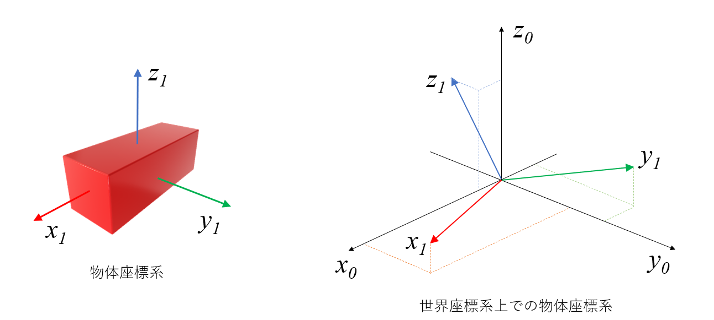
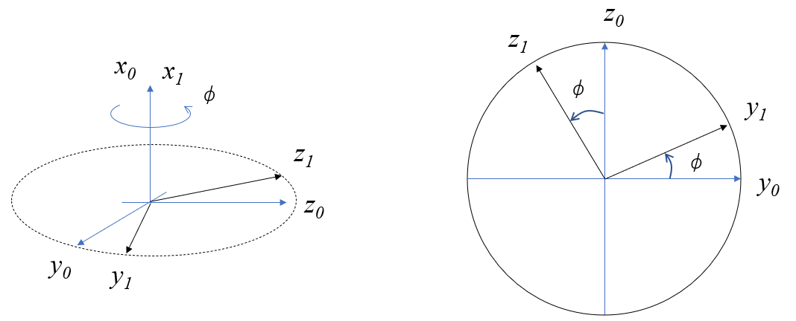
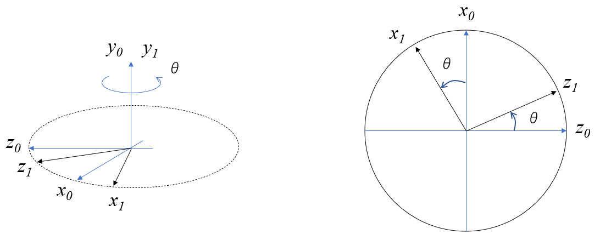
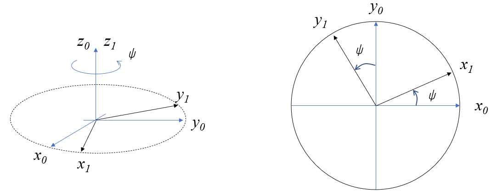

## 1. 回転行列について

物体に張り付き、物体の位置・姿勢の変化とともに変化する座標系を物体座標系と呼ぶ。
この物体の姿勢を動かない座標系である世界座標系の上での表し方の一つに回転行列がある。

以下の図のように、物体座標系として$\Sigma_1$があり、世界座標系として$\Sigma_0$があるとする。座標系の表し方として、それぞれに直交する単位行列$x,y,z$を右手座標系として構成する。

$$
\Sigma_0 = \begin{bmatrix}x_0 & y_0 & z_0 \end{bmatrix}
=\begin{bmatrix}
1 & 0 & 0 \\
0 & 1 & 0 \\
0 & 0 & 1 \\
\end{bmatrix}
$$

世界座標系上での物体の姿勢は初期では以下のようにそれぞれの単位ベクトルが一致している。

$$
\begin{aligned}
x_1 &= x_0 \\
y_1 &= y_0 \\
z_1 &= z_0
\end{aligned}
$$

次に物体の姿勢が変更したとき、下の右部のように$x_1, y_1, z_1$が$x_0, y_0, z_0$からずれることになり、このとき世界座標系上での物体の姿勢を単位行列を用いて次のように表すことが出来る。これを回転行列と呼ぶ。これは単位行列の列を並べたものであり、右手系をなすため、正規直交基底となる。

$$
^0 R_1 = \begin{bmatrix} x_1 & y_1 & z_1 \end{bmatrix} =\begin{bmatrix}
x_{1,x} & y_{1,x} & z_{1,x} \\
x_{1,y} & y_{1,y} & z_{1,y} \\
x_{1,z} & y_{1,z} & z_{1,z} \\
\end{bmatrix}
$$

世界座標の姿勢$\Sigma_0$がある変換行列に$R$によって、$^0R_1$になったと考えることが出来る。

$$
^0R_1 = R \ \Sigma_0
$$

$\Sigma_0$は単位行列であるため、$R={^0}R_0$となり、変換行列自体が姿勢を示す回転行列でもある。

### 1.1. 各座標を基準軸とした回転行列

物体座標$\Sigma_1$の初期姿勢が世界座標$\Sigma_0$となっている状態で、$x,y,z$それぞれの軸で回転を行った場合の回転行列を示す。

#### 1.1.1. $x$軸回転

$x$軸で回転させることにより、$x_0=x_1$であり、$y_1,z_1$が$y_0, z_0$から変化する。

- $y_1$は$y_0 - z_0$平面で示され、$(\cos(\phi), \sin(\phi))$
- $z_1$は$y_0 - z_0$平面で示され、$(-\sin(\phi), \cos(\phi))$

これより、$x$ 軸周りの回転行列 $E_x(\phi)$ は以下となる。

$$
E_x(\phi) = \begin{bmatrix}
1 & 0 & 0 \\
0 & \cos(\phi) & -\sin(\phi) \\
0 & \sin(\phi) & \cos(\phi)
\end{bmatrix}
$$

#### 1.1.2. $y$軸回転

$y$軸で回転させることにより、$y_0=y_1$であり、$x_1,z_1$が$x_0, z_0$から変化する。

- $x_1$は$x_0 - z_0$平面で示され、$( \cos(\theta), -\sin(\theta) )$
- $z_1$は$x_0 - z_0$平面で示され、$( \sin(\theta), \cos(\theta) )$

これより、$y$ 軸周りの回転行列 $E_y(\theta)$ は以下となる。

$$
E_y(\theta) = \begin{bmatrix}
\cos(\theta) & 0 & \sin(\theta) \\
0 & 1 & 0 \\
-\sin(\theta) & 0 &\cos(\theta)
\end{bmatrix}
$$

#### 1.1.3. $z$軸回転

$z$軸で回転させることにより、$z_0=z_1$であり、$x_1,y_1$が$x_0, y_0$から変化する。

- $x_1$は$x_0 - y_0$平面で示され、$( \cos(\theta), \sin(\theta) )$
- $x_1$は$x_0 - y_0$平面で示され、$( -\sin(\theta), \cos(\theta) )$

これより、$z$ 軸周りの回転行列 $E_z(\psi)$ は以下となる。

$$
E_z(\psi) = \begin{bmatrix}
\cos(\psi) & -\sin(\psi) & 0 \\
\sin(\psi) & \cos(\psi) & 0 \\
0 & 0 & 1\\
\end{bmatrix}
$$

