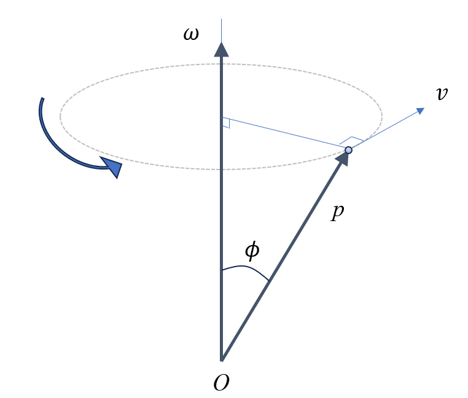
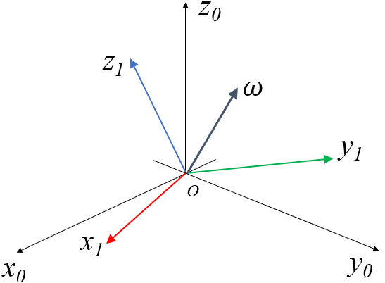

## 1. 外積行列

$a,b$ をベクトルとして以下で定義する。

$$
a = \begin{bmatrix}
a_x \\ a_y \\ a_z
\end{bmatrix} , \quad
b = \begin{bmatrix}
b_x \\ b_y \\ b_z
\end{bmatrix} 
$$

この外積は以下で計算できる。

$$
a \times b = \begin{bmatrix}
a_y b_z - a_z b_y \\
- a_x b_z + a_z b_x \\
a_x b_y - a_y b_x
\end{bmatrix}
$$

これを行列の積として表現しなおすと、以下のようになる。

$$
a \times b = \begin{bmatrix}
0 & -a_z & a_y \\
a_z & 0 & -a_x \\
-a_y & a_x & 0
\end{bmatrix}
\begin{bmatrix} b_x \\ b_y \\ b_z \end{bmatrix}　= a^\land \  b
$$

このような行列形式で外積計算を示すものを外積行列と呼ぶ。

外積行列は歪対称行列であり、以下の性質がある。

$$
\left(a^\land \right)^T = - a^\land
$$

## 2. 角速度ベクトル

物体がある軸 $a$ で周りに $\dot{\theta}$ の速度で回転しているとすると、その回転を角速度ベクトル $\omega$ として、以下で定義する。

$$
\omega  = \dot{\theta} a
$$

このように角速度ベクトルは、あるベクトルと、スカラーの値で定義することが出来る。

そして、その回転方向はベクトル $a$ の右ねじの方向を正とする。

### 2.1. 回転するベクトルの速度

角速度ベクトル $\omega$ が以下のようにあり、その $\omega$ により、点 $p$ は以下で計算される接線速度 $v$ を持つ。 $v$ は図のように $\omega$ にも $p$ にも直交するベクトルとなる。

$$
v = \omega \times p 
$$

そしてこの $v$ の大きさは、外積の大きさより、次で計算できる。

$$
|v| = |\omega| |p| \sin(\phi)
$$

この関係は、$p$ の時間微分として捉えるとことができ、次のようになる。

$$
\dot{p} = \omega \times p 
$$

実際に、 $z$ 軸の回転行列の $x$ 列ベクトル $e_x$ を取り出し、 $z$ 軸で $\dot{\theta}$ の角速度があるときの $e_x$ の速度を計算してみると、

$$
e_x = E_z(\theta)_x = \begin{bmatrix} \cos(\theta) \\ \sin(\theta) \\ 0 \end{bmatrix} \quad \rightarrow \quad \dot{e}_x =  \begin{bmatrix} -\dot{\theta} \sin(\theta) \\ \dot{\theta} \cos(\theta) \\ 0 \end{bmatrix}
$$

$$
\omega \times e_x = \begin{bmatrix} 0 \\ 0 \\ \dot{\theta} \end{bmatrix} \times 
\begin{bmatrix} \cos(\theta) \\ \sin(\theta) \\ 0 \end{bmatrix} =
\begin{bmatrix} 
-\dot{\theta} \sin(\theta) \\ \dot{\theta} \cos(\theta) \\ 0 
\end{bmatrix}
$$

のようになるため、 $\dot{e}_x = \omega \times e_x$ である。

### 2.2. 回転行列の時間微分

回転行列の時間微分を考える。2.1. 節では回転行列の $x$ 列ベクトルを取り出したが、これを一般的な形で書くと、以下の図のように、回転行列と角速度ベクトルがあり、それによりそれぞれの基底ベクトルの先端に接線速度が生じるというイメージになる。

これを式で説明する。

回転行列 ${^0}R_1$ を以下のように示す。

$$
{^0}R_1 = \begin{bmatrix} {^0}x_1 & {^0}y_1 & {^0}z_1 \end{bmatrix}
$$

この時間微分は以下となる。

$$
{^0}\dot{R}_1 = \begin{bmatrix} {^0}\dot{x}_1 & {^0}\dot{y}_1 & {^0}\dot{z}_1 \end{bmatrix}
$$

回転行列の各基底ベクトルはそれぞれ独立に動くのではなく、すべてが一緒に動く。よって、一つの角速度ベクトルで回転するとなる。よって、それぞれの基底ベクトルの時間微分は次のようになる。

$$
\begin{aligned}
{^0}\dot{x}_1 &= {^0}\omega_1 \times {^0}x_1 = {^0}\omega_1^\land \ {^0}x_1\\ 
{^0}\dot{y}_1 &= {^0}\omega_1 \times {^0}y_1 = {^0}\omega_1^\land \ {^0}y_1 \\
{^0}\dot{z}_1 &= {^0}\omega_1 \times {^0}z_1 = {^0}\omega_1^\land \ {^0}z_1
\end{aligned}
$$

これらを行列にまとめると、以下となる。

$$
\begin{aligned}
{^0}\dot{R}_1 &= \begin{bmatrix}
{^0}\omega_1^\land \ {^0}x_1 & {^0}\omega_1^\land \ {^0}y_1 & {^0}\omega_1^\land \ {^0}z_1 
\end{bmatrix} \\
&= {^0}\omega_1^\land \begin{bmatrix} {^0}x_1 & {^0}y_1 & {^0}z_1 \end{bmatrix} \\
&= {^0}\omega_1^\land {^0}R_1
\end{aligned}
$$

上記の式は、角速度ベクトルを世界座標で表した場合の関係である。

### 2.3. 物体座標系で表現した場合

物体座標系 $\Sigma_1$ で示された角速度 ${^1}\omega_1$ を世界座標で表すには回転行列 ${^0}R{_1}$ を用いて次のよう行う。

$$
{^0}\omega_1 = {^0}R{_1} {^1}\omega_1
$$

また、外積行列には次の性質がある。

$$
\left[ R a\right]^\land = R [a]^\land R^T
$$

これらを用いて 

$$
\begin{aligned}
{^0}\dot{R}_1 &= {^0}\omega_1^\land \ {^0}R_1 \\
&= \left[ {^0}R{_1} {^1}\omega_1 \right]^\land \ {^0}R_1 \\
&= {^0}R{_1} \left[ {^1}\omega_1 \right]^\land \left({^0}R{_1} \right)^T \ {^0}R_1 \\
&= {^0}R{_1} \left[ {^1}\omega_1 \right]^\land
\end{aligned} 
$$

以上より、角速度ベクトルを物体座標系か世界座標系で表すかにより、次のように式が変化する。

- 角速度ベクトルを世界座標系で表現する場合

$$
^0 \dot{R} = [{^0}\omega]^\land \ {^0}R
$$

- 角速度ベクトルを物体座標系で表現する場合

$$
^0 \dot{R} =  {^0}R \ [{^0}\omega]^\land
$$
